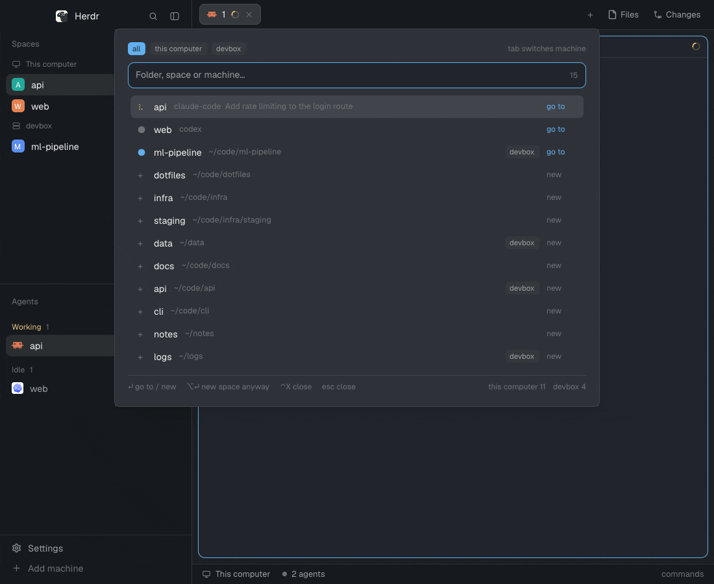

# herdr-app-navigator

Access all your projects and agents across all your machines from a single place.



Navigator is a mod for [herdr-app](https://herdr.dev), the desktop app that arranges the terminals and coding agents herdr-core (`hc`) runs into spaces and tabs. Press `cmd-p` and one ranked list shows every open space, agent, and [zoxide](https://github.com/ajeetdsouza/zoxide) folder on this computer and on every machine connected to herdr-core. Type a few letters of a project or machine name, then press enter to switch to the space already working in that folder, jump to an agent, or start a new space there on the right machine.

Working across machines usually means remembering which host holds a project and opening it by hand. Navigator searches all of them at once: folder names, paths, agent titles, and machine names. When a space already has a terminal in the folder, enter goes there instead of making a second one. Agent rows carry live status, so the list also shows which agents are working, blocked, done, or idle.

## Requirements

- herdr-app and herdr-core. Navigator is tested with herdr-app 0.1.11 and herdr-core (`hc`) 0.1.16.
- zoxide on every machine whose folders you want in the list. Navigator calls `zoxide` by name, so it must be on the `PATH` that herdr-app runs with on this computer, and on the `PATH` that herdr-core runs with on each other machine.

## Install

Clone this repository and copy the mod into your herdr-app home:

```sh
git clone https://github.com/alizdavoodi/herdr-app-navigator.git
cd herdr-app-navigator
mkdir -p ~/.config/herdr-app/mods
cp -R mods/navigator ~/.config/herdr-app/mods/
```

Bind a key that opens Navigator. If you have no `~/.config/herdr-app/keys.json` yet, copy the one from this repository:

```sh
cp keys.json ~/.config/herdr-app/keys.json
```

If you already have a `keys.json`, add this entry to its `global` section instead. If `cmd-p` already does something for you, pick which binding keeps it.

```json
"cmd-p": "mod.open:navigator"
```

Check that the mod loads:

```sh
herdr-app check ~/.config/herdr-app/mods/navigator
```

The command prints `check passed:` followed by the mod's path. Press `cmd-p` in herdr-app to open Navigator.

> [!NOTE]
> If you set `HERDR_APP_HOME`, use that folder in place of `~/.config/herdr-app`.

## Keys

| Key | Action |
| --- | --- |
| `cmd-p` | Opens Navigator. |
| Typing | Filters the list and selects the top row. |
| `ctrl-w` | Deletes the last word of the query. |
| `up`, `down` | Moves the selection. The selection wraps at both ends. |
| `enter` or click | Goes to the selected space or agent, or makes a new space in the selected folder. |
| `cmd-enter` | Opens the agent step for the selected space, agent, or folder row, without switching. See [Start an agent](#start-an-agent). On **New space…**, it does nothing. |
| `alt-enter` | Makes a new space in the selected row's folder, even when a space is already open there. |
| `ctrl-x` | Closes the selected space, and herdr-app asks you to confirm. On an agent row, press it twice to close that agent's pane. On a folder row or on **New space…**, it does nothing. |
| `tab` | Switches the machine filter to all machines, this computer, and then each connected machine. Clicking a chip at the top picks a filter. |
| `escape` | Closes Navigator. |

The first `ctrl-x` on an agent row changes the footer to `⌃X again closes <app> in <row>`. Any other key cancels it.

`ctrl-w` always deletes from the end of the query, even after the arrow keys move the caret, because the search field does not report where the caret is.

## What the list shows

- A row with a dot or a spinner is an open space or an agent. A row with `+` is a zoxide folder with no open space.
- With an empty query, open spaces and agents come first, in the order working, blocked, done, idle, and then spaces with no agent. Folders follow, sorted by their zoxide score.
- When you type, rows that carry an agent come first, then other open spaces, then folders. Within each of those, the better match comes first.
- A space with one agent shows the agent's app and title in place of its path. It shows the app alone when the title is empty or repeats the app's name. Enter opens the tab that holds that agent.
- A space with two or more agents shows one row per agent, named `space › tab N`, or `space › <tab name>` when the tab has a name.
- A row from another machine carries a chip with that machine's name.
- The last row is always **New space…**. Picking it asks for a name and makes a space in `~` on this computer. When the filter is another machine, the space starts in that machine's home folder.
- The number in the search field counts the matching rows, without **New space…**.

Each word you type must match a row for the row to stay. A word matches when the row's name contains it, when its letters appear in order in the name, when the path contains it, or when the machine name contains it. For a space with agents, the path also includes each agent's app and title. This computer's machine name is "this computer". Matching ignores case.

## Start an agent

`cmd-enter` on a row opens the agent step inside the same popup. The top line reads `Launch in <space>`, with ` on <machine>` for a row from another machine. On a folder row it reads `Launch in <folder> (new space)`. Below it is a field for an optional first message, and below that one row per agent: `claude`, `codex`, `pi`, and `omp`. Each agent row shows the command it runs and where it opens. An agent that the machine does not have shows "not installed" and cannot be picked.

| Key | Action |
| --- | --- |
| `up`, `down` | Moves the selection over the agents. The selection wraps at both ends. |
| `enter` or click | Starts the selected agent and closes Navigator. |
| `backspace` | With the message field empty, goes back to the list with your query as you left it. Otherwise it deletes as usual. |
| `escape` | Closes Navigator. |

On a space row, the agent starts in a new tab of that space. On a folder row, it starts in a new space in that folder, on the row's machine. Whatever you type in the message field becomes the agent's first message. Leave it empty to start the agent with no message.

The new tab is named after the agent, for example `claude`. If the space already has a tab with that name, the new one is `claude 2`, then `claude 3`, and so on.

When the agent exits with code 0, its tab closes. When it exits with any other code, the tab stays open with the agent's output. If the agent's tab is the only tab in its space, the space closes with it.

The list of agents comes from herdr on each machine. herdr's program table has no `omp` entry, so Navigator adds `omp` itself when herdr leaves it out. Picking `omp` on a machine that lacks it leaves a tab with the shell's error.

## Remote machines

Navigator reads the machine list from `hc machine ls` each time it opens. It lists every machine in the `connected` state, except machines added with `--temp`. To add a machine that you reach over ssh, run:

```sh
hc machine add vps
```

Each machine loads on its own. Open spaces show at once, and each machine's folders appear when that machine answers. A machine that connects while Navigator is open appears the next time you open it.

## Errors

The footer shows each machine's state: a spinner while it loads, its folder count when it is ready, and `<machine> unavailable` when it fails. For failed machines, a second line shows `<machine>: <reason>`. The reason is one of these:

- The first line of the error when `zoxide` cannot start, for example when it is not installed.
- The first line of what `zoxide` wrote to stderr.
- `zoxide exited <code>` when `zoxide` failed and wrote nothing.

A failed machine's open spaces still show. If `hc machine ls` fails, Navigator lists this computer only. If `printenv HOME` fails on a machine, that machine's paths show in full instead of starting with `~`.

## Programs and commands it runs

> [!IMPORTANT]
> Navigator runs programs. Each time it opens, it runs `hc machine ls --json`, `zoxide query -l -s` on every listed machine, and `printenv HOME` on every machine other than this computer. It also asks herdr-core which agents each machine has, through `knownAgents`. herdr-core runs the commands on other machines through its connection to them. Navigator reads no files and makes no network requests of its own.

It changes herdr-app only through these commands: `space.select`, `space.new`, `space.close`, `tab.new`, `agent.focus`, and `pane.close`. For **New space…**, it opens herdr-app's built-in `prompt` mod, which runs `space.new` with the name you type.

To start an agent, it runs `tab.new` or `space.new` with an `argv` and, when you typed a first message, a `task`. The `argv` runs `sh -c`, which starts `$SHELL -i -c "<command>"` so agents defined as shell functions work, then calls `hc kill` on the agent's own terminal when the agent exits with code 0.

## Rebuild the mod or the preview

[RECIPE.md](RECIPE.md) describes what the mod shows, how it behaves, and what a fresh build tends to get wrong, so you can build it again from an empty folder. `scripts/preview.sh` opens a herdr-app window with demo data and saves `preview.png` and `preview.gif` from it. On macOS, it types and clicks for the GIF itself. Run `scripts/preview.sh` with no arguments to see its commands.

## Credit

The idea comes from [thanhdat77/herdr-navigator](https://github.com/thanhdat77/herdr-navigator), a navigator plugin for Herdr. This repository is a separate implementation for herdr-app.
