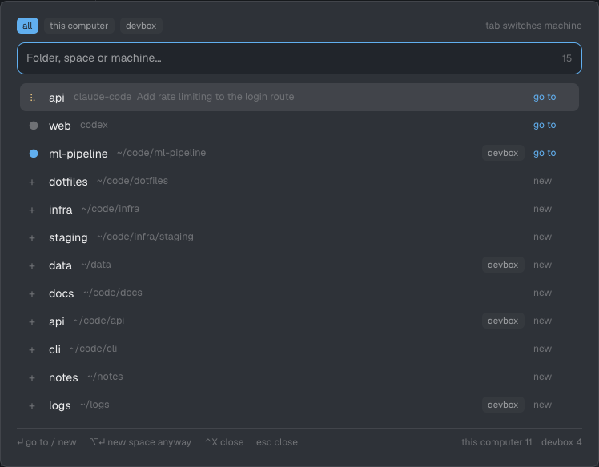

# Navigator

A popup at the top of the window for jumping to a folder. You type a few letters, and one ranked list shows matching zoxide folders from this computer and every connected machine, along with every open space. Enter goes to the space already working in that folder, or makes a new space there on the right machine.

## What you see

The popup is 680px wide and up to 80% of the window tall. It sits 40px below the top edge on the theme's `popover` color, with 18px padding and 13px text. From top to bottom:

1. **Machine chips.** One 18px-tall chip each for "all", "this computer", and every connected machine, with 10.5px text and 5px corners. The selected chip is `accent` with `accent_foreground` text. The others are `raised` with `muted` text. "tab switches machine" sits at the right in 11px `dim` text.
2. **Search field.** It is 36px tall with 9px corners, a 1px `accent` border, and a `background` fill. It holds the input (placeholder "Folder, space or machine…") and the count of matching rows in 11px `dim` text.
3. **Rows.** At most 12 rows show at a time, each 32px tall with 7px corners. The selected row has the `hover` background. Each row shows, from left to right:
	- A glyph in a 13px box. A folder row has a `dim` `+`, since Enter makes a space there. An open-space row has a `●` in its agent status color (`working`, `blocked`, `done`, `idle`), or `accent` when no agent reports. A space with a working agent shows a braille spinner in `working` instead.
	- The name, at most 220px wide, in `foreground`. It is the space name for an open row (semibold) and the last path segment for a folder row.
	- The path in 11.5px `dim` text, with the machine's home shortened to `~`. This computer's home comes from `home()` even when its zoxide fails. It truncates at the end.
	- A machine chip, only on rows from another machine.
	- "go to" in `accent` on open rows, or "new" in `dim` on folder rows.
4. **Empty state.** "Loading…" while any machine is still loading, else "Nothing matches".
5. **Footer.** A 1px `border` line on top, then 11px `dim` text. The left side lists the keys: "↵ go to / new", "⌥↵ new space anyway", "⌃X close space", and "esc close". The right side shows each machine's state: a braille spinner and its name while it loads, its name and folder count when ready, or "<name> unavailable" in `muted` on failure. If any machine failed, a second line in `muted` reads `<name>: <reason>` for each one. The reason is the first line of the error `exec` gave or of zoxide's stderr, else `zoxide exited <code>`.

## How it behaves

- Typing filters and ranks the list and moves the selection to the top row. Navigator splits the query on whitespace, and every word has to match. A word scores 100 when it equals the row's name, 80 when the name starts with it, 60 when the name contains it, and 30 when its letters appear in order in the name. It scores 20 when the `~` path contains it, and 10 when the machine name ("this computer" for this one) contains it. A word that matches none of these drops the row. Matching ignores case.
- The rank is the score sum times 10, plus 250 for an open space, plus `ln(frecency + 1) * 6`. With an empty query, open spaces come first, then folders by zoxide frecency.
- A folder is open when a terminal in a space on the same machine has that exact live working directory. A space with no terminal counts as open in its own folder (its machine's home when the folder is empty). An open space whose folders zoxide does not list still gets its own row.
- `enter` or a click on a row goes to the open space with `space.select`. On a folder row, it makes a space there with `space.new`. `alt-enter` always makes a new space. `ctrl-x` on an open row closes the popup and runs `space.close`, and the app asks to confirm. `ctrl-x` does nothing on a folder row.
- `up` and `down` move the selection and wrap at the ends. The 12-row window follows the selection and keeps it in the middle where it can.
- `tab` steps the machine filter through all, this computer, and each connected machine. Clicking a chip picks that filter.
- `escape` closes the popup. Each action that leaves (go, new, close) closes the popup first.
- Open spaces show the moment the popup opens. This computer's folders and each remote machine's folders appear as each one answers. A slow machine never holds up the others.

## Built from

- One mod, `mods/navigator/`, made of two files: `main.js` and `mod.json`. `mod.json` is `{ "place": "none", "title": "Navigator", "overlay": { "kind": "popup", "at": "top", "offset": 40, "width": 680, "height": 0.8 } }`. `keys.json` binds `"cmd-p": "mod.open:navigator"` in `global`.
- `herdr` functions: `spaces()`, `panes()`, `hc`, `exec`, `run`, `theme()`, `props()`, `closeOverlay`, and `home()`.
- Programs: `hc machine ls --json` once, keeping machines with `state == "connected"` and not `temporary`. On each machine, it runs `zoxide query -l -s` and `printenv HOME` through `exec(cmd, args, { on: machine })`. This computer uses `home()` instead of `printenv`.
- Commands: `space.select {id}`, `space.new {folder, machine?}` (no `machine` for this computer), and `space.close {id}`.
- Data: one state per machine (`loading`, `ready` with home and folders, or `error` with a reason). Every render derives the open-folder index from `spaces()` and `panes()`, and builds the ranked rows from those states, the query, and the machine filter. Keys go through a table from the `keystroke` string to an action.
- Art: text glyphs only. The spinner cycles `⠋⠙⠹⠸⠼⠴⠦⠧⠇⠏` with the native `.frames(SPIN, 90)`, never a timer.

## Watch out

- Match open spaces on the terminals' live `cwd`, not on `space.folder`. A space's folder is only where new terminals start, so a space made at home with its shell in `~/projects/app` would otherwise claim the home folder.
- Map each pane to its space through `spaces()[i].tabs`, since `panes()` gives only the tab id.
- Call `zoxide` by name. A hardcoded path breaks on other machines. Each machine's herdr-core needs zoxide on its own `PATH`.
- `exec` rejects when the program cannot start and resolves with a nonzero `code` when it fails. Treat both as an error for that machine, and show the reason in the footer.
- `enter` can reach both the key handler and the input's `submit`. The mod acts on the first one and ignores the rest, so it never makes two spaces.
- herdr-app draws nothing for an SVG reached through a symlink. home-manager and stow install every file as a symlink, so the mod draws text glyphs instead of `svg()` icons.
- Selection is an index. It resets to the top when the query or the filter changes. A machine that answers late can reorder the list under the selection.
- Machines come from one `hc machine ls` call when the popup opens. A machine that connects while the popup is open shows up the next time it opens.

## Done when

- `herdr-app check mods/navigator` passes.
- With a space whose terminal sits in a zoxide folder, typing part of that folder's name puts an open row ("go to") at the top. Enter switches to that space.
- Enter on a folder row makes a new space in that folder, on that row's machine.
- `alt-enter` on an open row makes a second space in the same folder.
- `ctrl-x` on an open row asks to close that space.
- With a remote machine connected, its folders appear with its chip. Typing the machine's name narrows to its rows, and `tab` cycles all, this computer, and the machine.
- On a machine without zoxide, the footer names it with the reason, and its open spaces still show.
